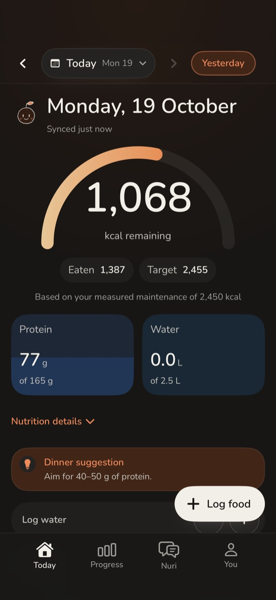
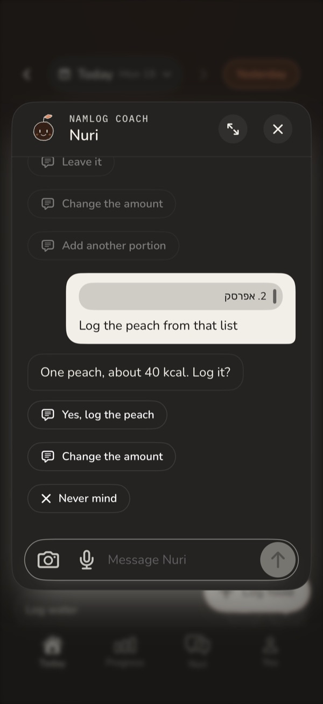
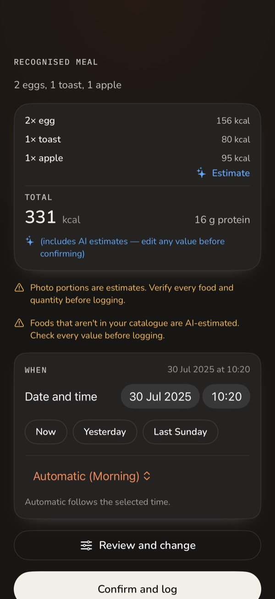
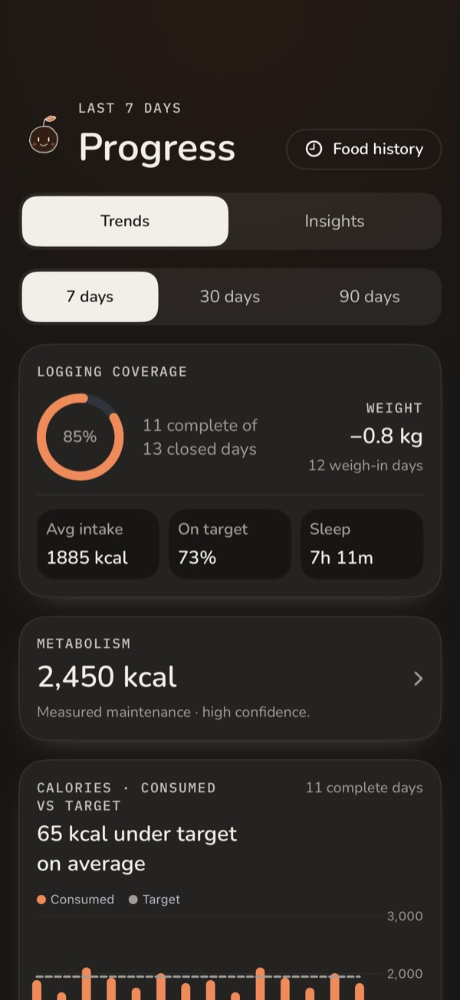

# Hi, I'm Nir 👋

**Senior DevOps Engineer from Israel** — I build cloud infrastructure, automation, developer tooling, and AI-agent infrastructure.

My background is IT and automation; these days I spend most of my time on backend and platform work: CLIs that bring GitOps to internal tools, MCP servers that let AI agents act safely, and a lot of Python and TypeScript glue in between.

---

### 🔨 Featured projects

| Project | What it is | Stack |
|---|---|---|
| [**MCPatch**](https://github.com/vaknir/MCPatch) | Turns websites into safe, typed MCP tools for AI agents. A capability broker between MCP clients and your existing browser session — named tools with declared schemas, origins and risk, never raw cookies or arbitrary JS. | Rust · TypeScript · Browser extension |
| [**portctl**](https://github.com/vaknir/portctl) | GitOps CLI for [Port.io](https://www.getport.io/) — `kubectl`/`terraform`-style pull, diff, push, drift detection and rollback for your developer portal config. | Python · Typer · CI |
| [**netdata_tegrastats**](https://github.com/vaknir/netdata_tegrastats) | Netdata plugin that adds NVIDIA Jetson Xavier GPU stats to the dashboard. | Python |

### 📱 Namlog — private project

A self-hosted nutrition & recovery coach for iOS. A deterministic engine sets the daily calorie target from your measured weight trend, health data (Apple Health / WHOOP) shapes the guidance, and an AI coach helps log meals by text, photo or barcode — every write is confirmed by you first.

**Stack:** SwiftUI · Python / FastAPI · PostgreSQL (row-level security) · OpenAI Responses API · Docker · Cloudflare Tunnel & Access

  
  
  
  

Source is private — happy to walk through it on request.

### 🧪 Currently tinkering with

- **MCP servers & AI agents** — giving Claude-style agents scoped, auditable access to real tools
- **Market tooling** — momentum scanners and paper-trading dashboards

### 🧰 Tools I use

